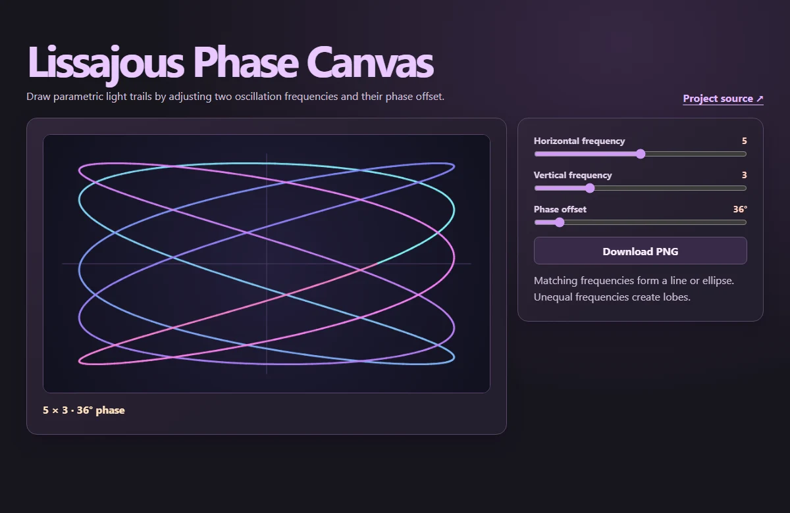

# Lissajous Phase Canvas

Draw parametric light trails by adjusting two oscillation frequencies and their phase offset.

[Open the browser app](https://surfingcoder.com/apps/lissajous-phase-canvas/)

## Run locally

Run the following command in this repository and open [localhost:8000](http://localhost:8000).

    python -m http.server 8000

The horizontal coordinate is the sine of its frequency times the tracing angle plus phase. The vertical coordinate uses its own frequency. The curve completes one full cycle and can be downloaded as a PNG.

## Verify

Run the following command with Node.js 22 or newer.

    node --test
